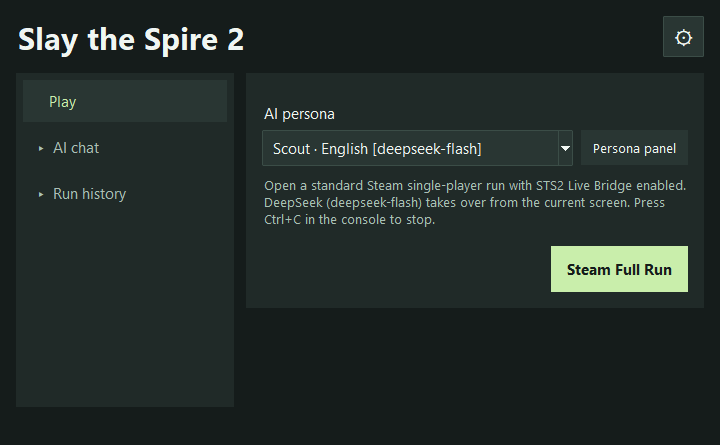
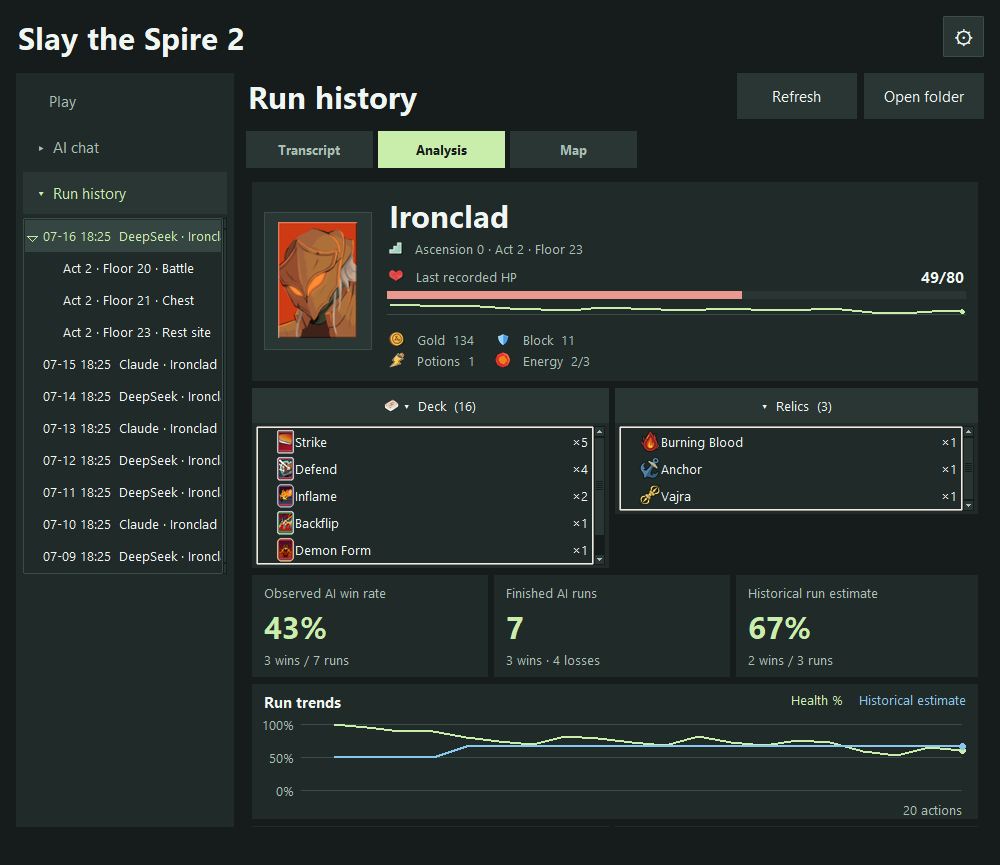
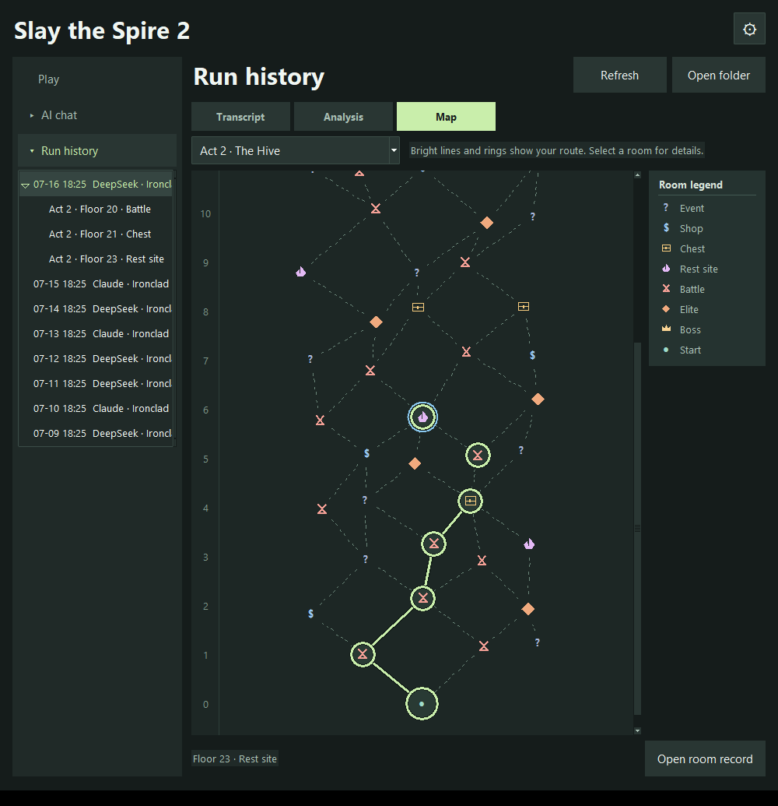
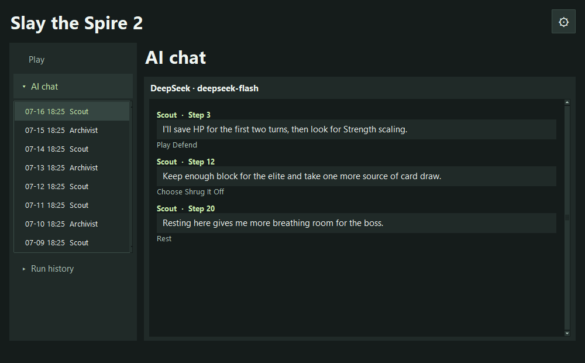

# Slay the Spire 2 desktop launcher

**English** · [简体中文](README.zh-CN.md)

A Windows desktop launcher for [sts2-cli](https://github.com/wuhao21/sts2-cli). Play manually or let a DeepSeek or Claude persona play, then review each room of the run. Play in a terminal with your local game engine, or let AI take over an active single-player run in the Steam game.

## Download and play

**[Download the Windows x64 Steam Full Run ZIP](https://github.com/fallingstars123/sts2-cli/releases/latest/download/sts2-cli-windows-x64.zip)**

1. Install **Slay the Spire 2** through Steam and download the ZIP.
2. Extract the entire ZIP into a writable folder and double-click `Start STS2.cmd`.
3. Copy the included Sts2LiveBridge folder into the game's mods directory, restart the game, and enable the bridge. Open a single-player run, select a persona, then click **Steam Full Run**.

The ZIP includes Python and the Steam bridge. Save your provider key in **API settings** in the gear menu and choose a model in **Persona panel**. AI play, model refresh, and the first installation of a provider client require internet access. For offline terminal play, see the [terminal package and supported game version](https://github.com/fallingstars123/sts2-cli/releases/tag/windows-v0.1.4).

### Steam Full Run

Enable **STS2 Live Bridge**, open a standard single-player run in Steam, and choose **AI play → Steam Full Run**. The selected DeepSeek or Claude model takes over the run you have open. The launcher records rooms, decisions, and results as you play. See the [Steam setup guide](docs/steam-mod.md) for installation and troubleshooting.

## Features

- **Personas and languages.** Save a model, speaking style, and output language per persona. The desktop menus in `STS2 Languages.json` and AI commentary each offer 17 language choices. The game adapter currently reads English and Simplified Chinese game text from `localization_eng` and `localization_zhs`.
- **Local saves.** Detect or set a save folder from the gear menu, then select a save on the launch page.
- **AI chat and run history.** Expand either view from the sidebar. Each run has its own archive, with separate folders for encounters, chests, rest sites, and other rooms.
- **Run maps.** Switch between runs and acts. The scrollable map follows the engine's room connections. Bold lines trace the traveled route and bright rings mark visited rooms. Select a visited room to open its record.
- **Game icons.** The launcher reads map, character, status, and card art from the local Steam install. Each card can show its own artwork inside a badge styled by pool, rarity, and type. The analysis and map views make no icon downloads.
- **Character and run analysis.** The top panel shows the portrait, HP, recent health changes, gold, block, potions, and combat energy when recorded. Expand Deck or Relics to see their icons and quantities. Historical charts appear below.

## Screenshots

The conversations, runs, and statistics below use sample data.

## Docs and license

- [Steam Live Bridge installation and full-run guide](docs/steam-mod.md)
- [Desktop launcher guide](docs/desktop-launcher.md)
- [Command-line play, source builds, and JSON protocol](docs/cli.md)
- [Release notes and downloads](https://github.com/fallingstars123/sts2-cli/releases)

This fork builds on [wuhao21/sts2-cli](https://github.com/wuhao21/sts2-cli) and is distributed under the [MIT license](LICENSE).
