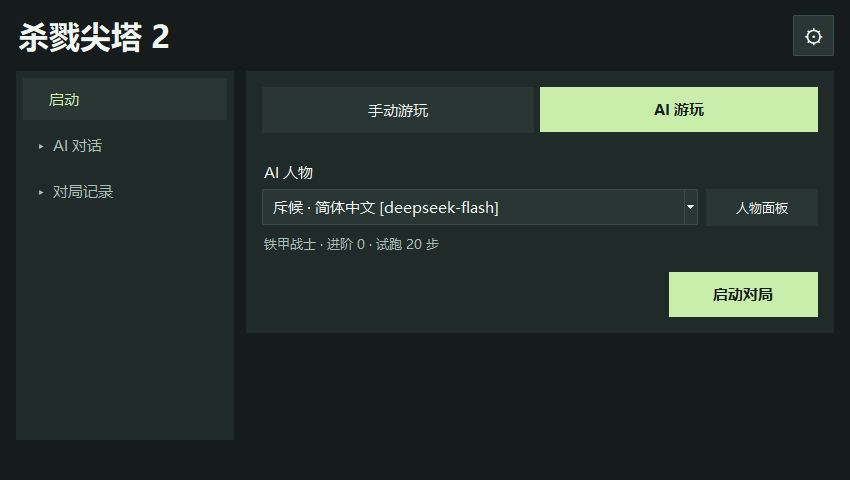
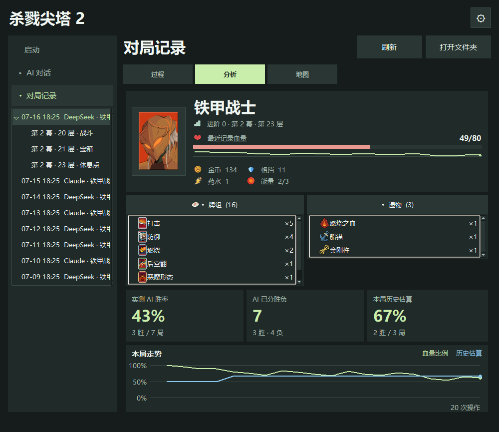
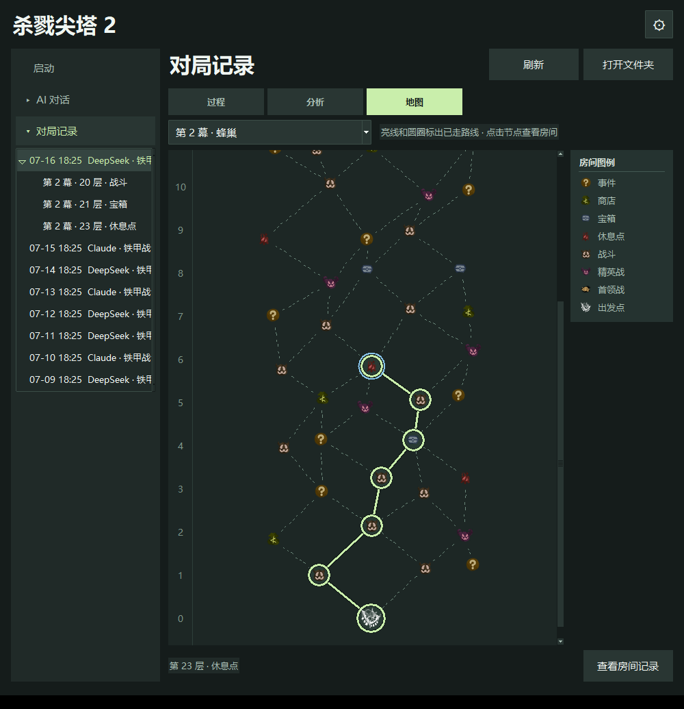
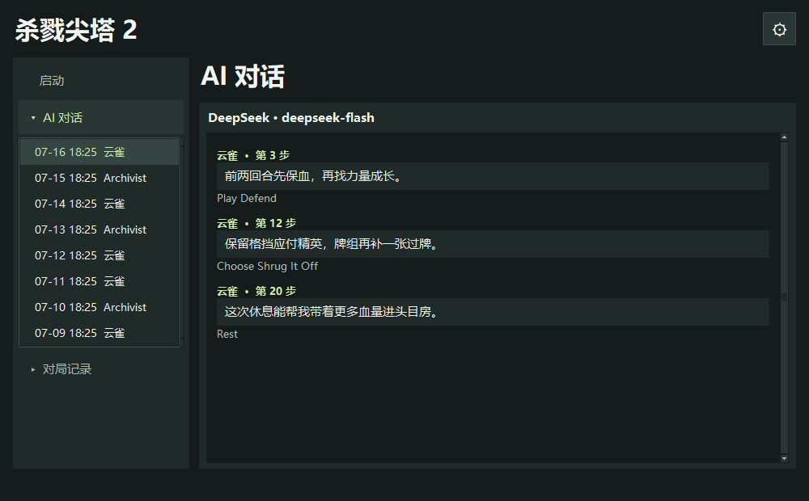

# 杀戮尖塔 2 桌面启动器

[English](README.md) · **简体中文**

这是为 [sts2-cli](https://github.com/wuhao21/sts2-cli) 增加的 Windows 桌面启动器。可以手动控制对局，也可以让 DeepSeek 或 Claude 游玩并回看每个房间的过程。对局通过本机 Steam 游戏引擎运行，操作和状态显示在游戏终端里。

## 下载与启动

**[下载 Windows x64 便携版 ZIP](https://github.com/fallingstars123/sts2-cli/releases/latest/download/sts2-cli-windows-x64.zip)**

1. 通过 Steam 安装《杀戮尖塔 2》，然后下载上面的 ZIP。
2. 将 ZIP 完整解压到一个可写目录，再双击里面的 `Start STS2.cmd`。
3. 选择 **手动游玩** 或 **AI 游玩**，点击 **开始对局**。首次开局会自动查找 Steam 游戏。如果找不到，选择游戏安装目录即可。

ZIP 已包含 Python 和 .NET 运行环境。安装 Steam 游戏后，手动游玩、读档、地图和分析都可离线使用。AI 游玩、手动刷新模型和安装缺失的 API 客户端时需要联网。

## 功能

- **人物与语言**。每个人物可保存模型、发言设定和输出语言。启动器菜单翻译集中在 `STS2 Languages.json`，与 AI 发言各有 17 种语言可选。游戏适配器目前使用 `localization_eng` 和 `localization_zhs` 中的英语和简体中文游戏文本。
- **本机存档**。在齿轮菜单自动查找或手动设置存档目录，回到开局页即可选择存档。
- **AI 对话与对局记录**。左栏展开相应视图。每局都有独立目录，战斗、宝箱、休息点等房间保存在各自的子目录。
- **对局地图**。可切换对局和章节。地图按引擎的房间连接布点，用粗亮线标出已走路线，并圈出每个已到访房间。选中房间即可打开对应记录。
- **游戏图标**。地图、角色、状态和卡牌原画直接读取本机 Steam 游戏。牌组小图显示各张卡的原画，外框区分牌池、稀有度和类型。分析和地图页面不会下载图标。
- **角色和对局分析**。页面顶部显示角色、血量走势，以及已记录的金币、格挡、药水和战斗能量。展开「牌组」或「遗物」即可查看名称、图标和数量。进行中的对局会自动更新。

## 界面预览

以下聊天内容、对局和统计均为演示数据。

## 文档与许可

- [桌面启动器使用指南](docs/desktop-launcher.md#中文)
- [命令行玩法、源码构建和 JSON 协议](docs/cli.md#中文)
- [版本更新与下载](https://github.com/fallingstars123/sts2-cli/releases)

本项目基于 [wuhao21/sts2-cli](https://github.com/wuhao21/sts2-cli)，沿用 [MIT 许可证](LICENSE)。
